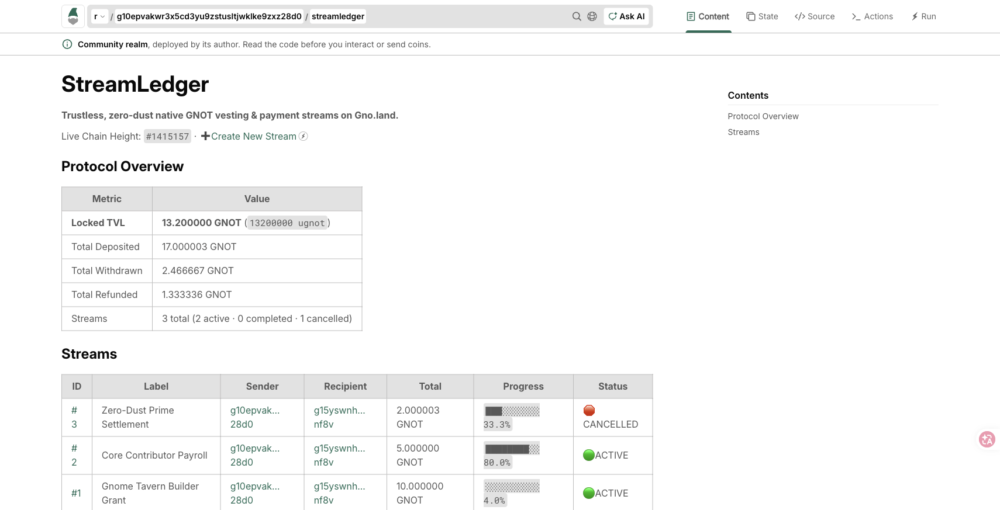
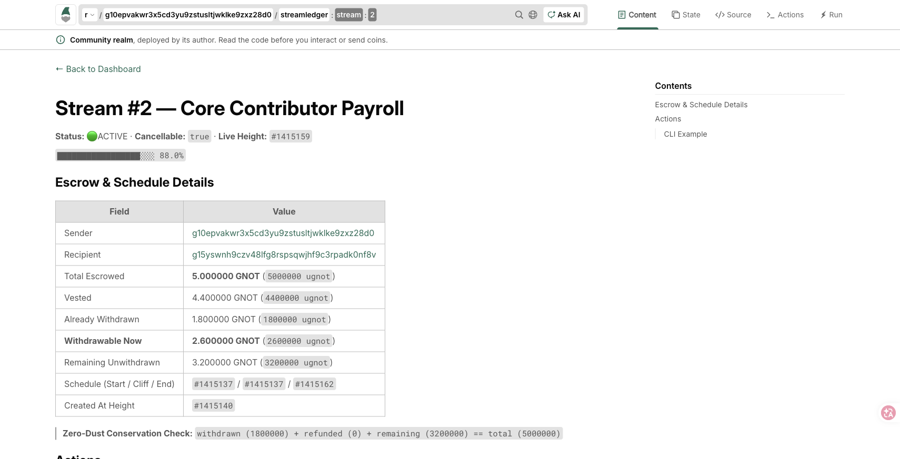
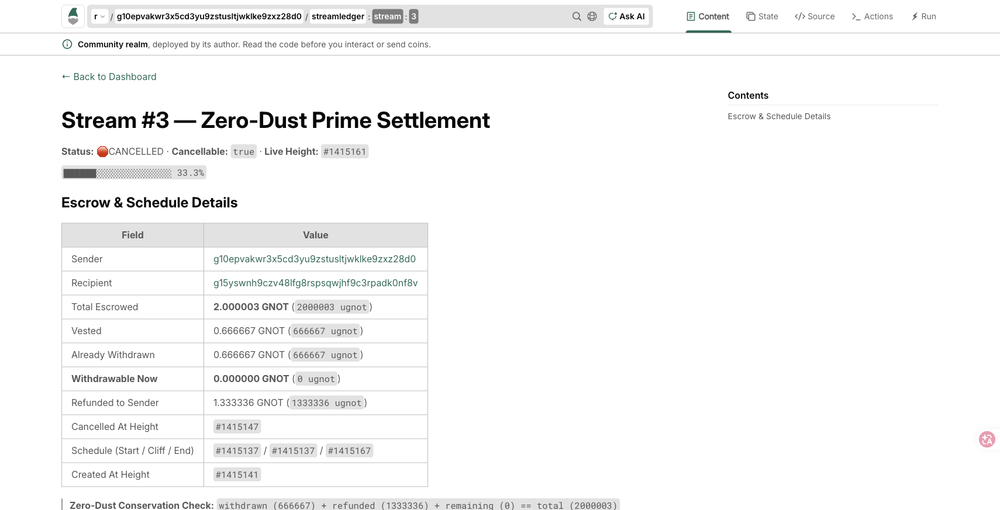
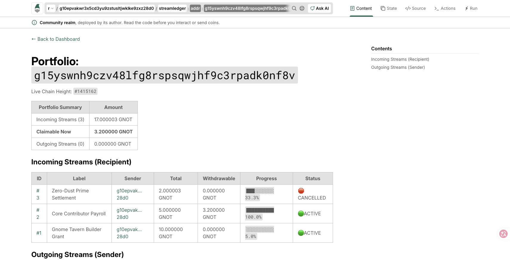

# StreamLedger

**Trustless, zero-dust native GNOT vesting and payment streams for Gno.land.**

StreamLedger splits vesting math and stateful escrow into two cleanly separated Gno.land modules:

- **Pure Composable Package** (`p/streammath`): Zero-dependency, 128-bit overflow-safe linear vesting math, zero-dust cancel settlement, basis-point progress tracking, Unicode progress bars, and `ugnot` formatting.
- **Stateful Escrow Realm** (`r/streamledger`): Strict Checks-Effects-Interactions (CEI) native `ugnot` escrow with `avl.Tree` indexing by stream ID, sender, and recipient, deterministic JSON query endpoints, and a rich interactive `gnoweb` dashboard.

---

## Architecture

```
                         ┌──────────────────────────────────────────────┐
                         │        p/.../streammath  (Pure Package)      │
                         │  • ValidateSchedule                          │
                         │  • VestedAmount (128-bit bits.Mul64/Div64)   │
                         │  • WithdrawableAmount                        │
                         │  • CancelSplit (exact zero-dust invariant)   │
                         │  • ProgressBps / ProgressBar / FormatUGNOT   │
                         └──────────────────────▲───────────────────────┘
                                                │ imports
                         ┌──────────────────────┴───────────────────────┐
                         │       r/.../streamledger (Escrow Realm)      │
                         │  Crossing API:                               │
                         │   • CreateStream   (EOA + ugnot escrow lock) │
                         │   • Withdraw       (recipient-only, CEI)     │
                         │   • CancelStream   (sender-only, zero-dust)  │
                         │   • TopUpStream    (sender-only, pre-end)    │
                         │  Read & UI API:                              │
                         │   • GetStreamJSON(id) / StatsJSON()          │
                         │   • Render("") | Render("stream/<id>")       │
                         │   • Render("addr/<g1...>")                   │
                         └──────────────────────────────────────────────┘
```

---

## Zero-Dust Math Proof & Overflow Safety

### 1. Exact 128-Bit Linear Vesting (No `int64` Overflow)

Naive linear vesting computes `totalAmount * elapsed / duration`, which overflows `int64` whenever `totalAmount * elapsed > 9.22 × 10¹⁸` (easily triggered by large GNOT grants over multi-year block schedules).

`streammath.VestedAmount` uses Gno's `math/bits` 128-bit primitives:

```go
hi, lo := bits.Mul64(uint64(totalAmount), elapsed)
quo, _ := bits.Div64(hi, lo, duration)
```

Because `0 < elapsed < duration`, we have `hi < duration`, guaranteeing that `bits.Div64` never overflows and always computes the exact floor $\lfloor \text{totalAmount} \cdot \text{elapsed} / \text{duration} \rfloor$.

### 2. Zero-Dust Conservation Theorem

When a stream is cancelled at height $h$, let $T = \text{totalAmount}$, $W = \text{withdrawn}$ ($0 \le W \le T$), and $R = T - W$. `CancelSplit` computes:

$$\text{toRecipient} = \min\bigl(R,\; \max(0,\; \text{Vested}(h) - W)\bigr)$$
$$\text{toSender} = R - \text{toRecipient}$$

Therefore:

$$W + \text{toRecipient} + \text{toSender} = W + \text{toRecipient} + (T - W - \text{toRecipient}) = T$$

**Every single `ugnot` is strictly conserved with zero rounding dust trapped in escrow.**

---

## Security Model

1. **Direct EOA Payment Verification**: `CreateStream` and `TopUpStream` enforce `cur.Previous().IsUserCall()` before reading `unsafe.OriginSend()`, blocking intermediate-realm envelope phishing, and reject any non-`ugnot` or multi-denom attachments.
2. **Strict Checks-Effects-Interactions (CEI)**: `Withdraw` and `CancelStream` finalize all stream state, status transitions, and protocol accounting counters *before* calling `banker.SendCoins`.
3. **Role Isolation**: Only the recipient can `Withdraw`; only the sender can `CancelStream` (on cancellable streams) or `TopUpStream` (before `endHeight`).
4. **Overflow Protection**: Protocol-level deposit totals and top-ups use `math/overflow.Add64`.

---

## Live Onyx Testnet (`onyx-1`)

- **Pure Package**: [`https://onyx.testnets.gno.land/p/g10epvakwr3x5cd3yu9zstusltjwklke9zxz28d0/streammath`](https://onyx.testnets.gno.land/p/g10epvakwr3x5cd3yu9zstusltjwklke9zxz28d0/streammath) (Block `#1402502`, Tx `+yEajXqZmFWdoA20S2hG1oJkb9PiyKN59hU7XEnlcN0=`)
- **Escrow Realm**: [`https://onyx.testnets.gno.land/r/g10epvakwr3x5cd3yu9zstusltjwklke9zxz28d0/streamledger`](https://onyx.testnets.gno.land/r/g10epvakwr3x5cd3yu9zstusltjwklke9zxz28d0/streamledger) (Block `#1402593`, Tx `1Qa34eO2nIBee9TzWLadcO3FZFfawQ+3Jaeham6eJno=`)
- **Deployer Address**: `g10epvakwr3x5cd3yu9zstusltjwklke9zxz28d0`
- **Test Recipient Address**: `g15yswnh9czv48lfg8rspsqwjhf9c3rpadk0nf8v`

### Verified Live On-Chain Transactions (`onyx-1`)

| # | Action | Block | Result / Conservation Proof | Tx Hash |
| --- | --- | --- | --- | --- |
| 1 | `CreateStream` #1 (Builder Retention Grant, 10 GNOT, cliff) | `#1415139` | Locked `10,000,000 ugnot` | `QefcScPF2+XNVcqSk0HAD4B/c3KDiQq7gyS4JV2XHw0=` |
| 2 | `CreateStream` #2 (Core Contributor Payroll, 5 GNOT) | `#1415140` | Locked `5,000,000 ugnot` | `uGGwymFvslq+dPJwI0nLmudw+l8TKygXslaUKDkzkaw=` |
| 3 | `CreateStream` #3 (Zero-Dust Prime Settlement, `2.000003` GNOT) | `#1415141` | Locked `2,000,003 ugnot` | `YffFw2+l5ayTDYWUcrm0ZCgImansmDpsZu7nSeJ1WNQ=` |
| 4 | `Withdraw(2)` by recipient | `#1415146` | Claimed `1,800,000 ugnot` | `llabejKhwDJE3MCeWO/bSTGC1mTmYr3qiJ8eJJSJb/Q=` |
| 5 | `CancelStream(3)` by sender | `#1415147` | **`666,667 + 1,333,336 == 2,000,003` (0 dust!)** | `jOJYciKDTDdWNlgHuR+Tvqkd4g2TchMStSelk5/UU5U=` |

- **Live `StatsJSON()` Parity**: `tvlUgnot: 13200000 == escrowBalanceUgnot: 13200000` (100% exact escrow backing).

### Demo Video & Live `gnoweb` Screenshots

- **Demo Video (60s, 1280×720 H.264)**: [`docs/streamledger_demo.mp4`](docs/streamledger_demo.mp4)

| Live Dashboard | Stream #2 Detail | Stream #3 Zero-Dust Proof | Recipient Portfolio |
| --- | --- | --- | --- |
|  |  |  |  |

---

## Local Verification (`gno test`)

```bash
# Test pure math package
gno test -v ./p/streammath

# Test escrow realm (with local package resolution)
gno test -v ./r/streamledger
```

---

## Deploying to Onyx Testnet (`onyx-1`)

```bash
# 1. Deploy pure math package first
gnokey maketx addpkg \
  -pkgpath "gno.land/p/g10epvakwr3x5cd3yu9zstusltjwklke9zxz28d0/streammath" \
  -pkgdir "./p/streammath" \
  -max-deposit 25000000ugnot \
  -gas-fee 1000000ugnot \
  -gas-wanted 35000000 \
  -chainid onyx-1 \
  -remote https://rpc.onyx.testnets.gno.land:443 \
  -broadcast \
  deployer

# 2. Deploy stateful escrow realm
gnokey maketx addpkg \
  -pkgpath "gno.land/r/g10epvakwr3x5cd3yu9zstusltjwklke9zxz28d0/streamledger" \
  -pkgdir "./r/streamledger" \
  -max-deposit 45000000ugnot \
  -gas-fee 1000000ugnot \
  -gas-wanted 60000000 \
  -chainid onyx-1 \
  -remote https://rpc.onyx.testnets.gno.land:443 \
  -broadcast \
  deployer
```

### Example Calls

```bash
# Create a 5 GNOT cancellable stream with a 20-block cliff over 100 blocks
gnokey maketx call \
  -pkgpath "gno.land/r/g10epvakwr3x5cd3yu9zstusltjwklke9zxz28d0/streamledger" \
  -func CreateStream \
  -args "<recipient_g1_addr>" \
  -args "<start_height>" \
  -args "<cliff_height>" \
  -args "<end_height>" \
  -args "true" \
  -args "Contributor Grant" \
  -send 5000000ugnot \
  -gas-fee 1000000ugnot \
  -gas-wanted 5000000 \
  -chainid onyx-1 \
  -remote https://rpc.onyx.testnets.gno.land:443 \
  -broadcast \
  deployer

# Recipient withdraws vested GNOT
gnokey maketx call \
  -pkgpath "gno.land/r/g10epvakwr3x5cd3yu9zstusltjwklke9zxz28d0/streamledger" \
  -func Withdraw \
  -args "1" \
  -gas-fee 1000000ugnot \
  -gas-wanted 5000000 \
  -chainid onyx-1 \
  -remote https://rpc.onyx.testnets.gno.land:443 \
  -broadcast \
  recipient
```

---

## License

MIT License © 2026 Jie Zhou
